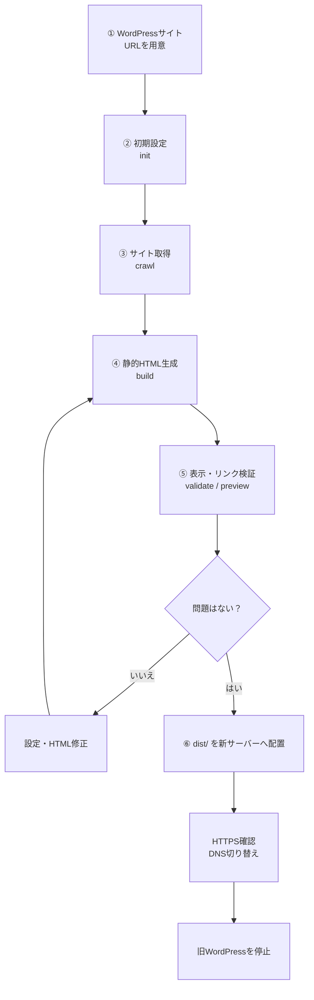
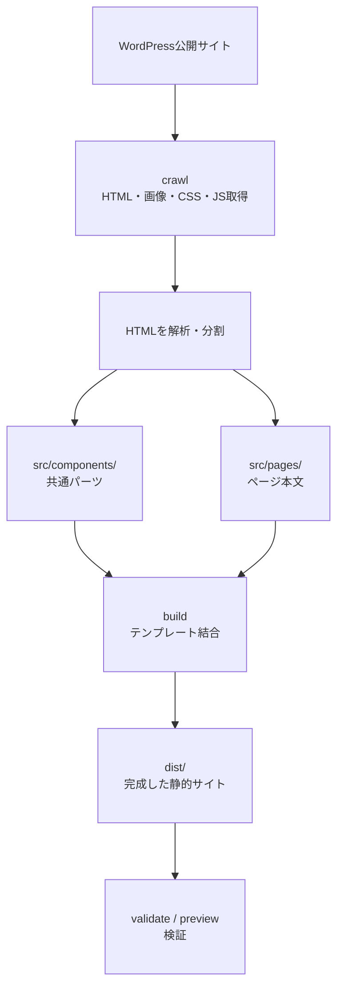

# WP Static Migrator（v0.1.0）

**プラグインを追加せずに**、公開されているWordPressサイトを、編集可能なHTMLソースと公開用の静的ファイルへ移行するCLIツールです。**自身が所有・管理するサイト、または移行の許可を得たサイト**にのみ使用してください。

WordPressの管理者アカウントやPHPは不要です。実行環境には **Node.js 20以上**が必要です。

## 開発への参加・ご協力のお願い

WP Static Migratorは、さまざまなWordPressサイトで利用できる汎用ツールを目指しています。バグ修正、機能改善、ドキュメントの改善など、皆さまのご協力を歓迎します。

GitHubでの参加方法は次のとおりです。

1. このリポジトリを **Fork** して、ご自身のGitHubアカウントにコピーします。
2. Forkしたリポジトリをローカルにクローンし、作業用ブランチを作成します。
3. 修正・追加を行い、動作を確認してコミットします。
4. 作業ブランチをFork先にPushし、**元のリポジトリの `main` ブランチ宛てにPull Request（プルリクエスト）** を作成してください。

```bash
# Fork後、ご自身のリポジトリをクローン
git clone https://github.com/YOUR_USERNAME/WPStaticMigrator.git
cd WPStaticMigrator
git switch -c fix/your-change

# 修正・動作確認後
git add .
git commit -m "fix: Describe your change"
git push -u origin fix/your-change
```

Pull Requestには、**変更の目的・修正内容・確認した動作**を記載してください。大きな変更を予定している場合は、先にIssueで方針を相談いただけると助かります。

## はじめての方へ：移行の全体像

WordPressをすぐに削除する必要はありません。まず公開中のサイトを取得し、新しい静的サイトをPCで確認してから公開します。



### 変換とビルドは何が違う？

- **変換（`crawl`）**：公開中のWordPressからページ、画像、CSS、JavaScriptなどを取得し、編集用のソースを作ります。
- **ビルド（`build`）**：ヘッダー・フッターなどの共通パーツとページ本文を結合し、公開用の `dist/` を作ります。
- **検証（`validate` / `preview`）**：リンク切れなどを検査し、ブラウザで表示を確認します。



**編集するのは `src/`、新サーバーへ公開するのは `dist/` です。** `src/components/header.html` や `footer.html` を編集した場合は、`build` を再実行すれば各ページに反映できます。

### まずは3つの操作で試す

最初にこのリポジトリのフォルダで `npm install` を実行してください。その後、次の順に操作します。

**1. URLを登録する**

```bash
node bin/wp-static-migrator.js init --url https://example.com --output ./my-site
```

`my-site/config.json` を確認し、取得対象や上限を必要に応じて調整します。

**2. 変換・ビルド・検証をまとめて実行する**

```bash
node bin/wp-static-migrator.js all --output ./my-site
```

**3. ブラウザで完成結果を見る（Python不要）**

```bash
node bin/wp-static-migrator.js preview --output ./my-site --port 8080
```

ブラウザで `http://localhost:8080/` を開きます。問題があれば `src/` のHTMLや設定を調整して `build` と `validate` を再実行してください。

> **重要：** 変換に成功しても、フォーム・検索・JavaScriptで動く機能まで移行できたとは限りません。DNS変更前に、元サイトとの表示比較と機能確認を行ってください。

## インストールと実行

```bash
npm install
node bin/wp-static-migrator.js init --url https://example.com --output ./my-site
# クロール開始前に my-site/config.json を確認・調整する
node bin/wp-static-migrator.js all --output ./my-site
node bin/wp-static-migrator.js report --output ./my-site
node bin/wp-static-migrator.js preview --output ./my-site --port 8080
```

Pythonや追加のWebサーバーパッケージは不要です。プレビューは安全のため `127.0.0.1` のみに公開されます。最後のコマンドを実行したら、ブラウザで `http://localhost:8080/` を開いて確認してください。

将来的にnpmへ公開した後は、`npx wp-static-migrator ...` という形式での実行を想定しています。**現時点ではnpm未公開です。**

## 生成されるファイル

| パス                                                     | 内容                                                          |
| -------------------------------------------------------- | ------------------------------------------------------------- |
| `my-site/src/components/{header,navigation,footer}.html` | 最初に取得したページから抽出した共通パーツ。編集可能          |
| `my-site/src/pages/**/index.html`                        | 各ページ固有のHTML                                            |
| `my-site/src/layouts/default.html`                       | Handlebarsによる共通レイアウト                                |
| `my-site/src/manifest.json`                              | ページのメタデータ                                            |
| `my-site/dist/`                                          | 公開用のHTMLとダウンロードした関連ファイル                    |
| `my-site/logs/`                                          | 取得エラー、共通パーツの差異、リンク切れ、WordPress依存の警告 |

共通パーツを編集した後は、以下のコマンドでHTMLを再生成できます。

```bash
node bin/wp-static-migrator.js build --output ./my-site
```

**注意：手動編集後に再度 `crawl` を実行すると、取得済みのページ本文が上書きされます。** 編集済みソースは事前にバックアップしてください。共通パーツのファイルは `crawl` で上書きされません。

## 対応範囲と制限事項

- 公開状態のHTMLと、同一ホスト上の関連ファイルを取得し、通常のリンクを巡回します。JavaScriptで描画されるページ、無限スクロール、ログインが必要なページ、検索、フォーム、WooCommerce、API呼び出し、WordPressの動的機能は**自動移行しません**。
- ヘッダー・フッターの検出には設定可能なCSSセレクターを使用します。最初に正常取得したページを共通パーツの初期値とします。`shared-variants.json` には、共通部分のHTMLが異なるページを記録します。**複数テンプレートを自動判定する機能ではありません。**
- クエリ文字列を含むページURLには、ハッシュ付きの出力パスを割り当てます。リダイレクトが必要になる場合があります。特殊なパーマリンクや絶対URL、canonical、alternateなどは確認してください。
- CSSの `url(...)` で参照するファイルは取得しますが、複雑なCSSの `@import`、外部リソースを読み込むJavaScript、レスポンシブ画像の `data-src` など、動的な依存関係には手動対応が必要な場合があります。
- 静的HTMLの生成は、**元サイトと同じ機能が動作することを保証しません**。DNS切り替えやWordPress停止の前に、PC・スマートフォンで表示を比較し、`validate` を実行してください。
- サイト管理者の許可を得て使用し、`delayMs` と `maxPages` は控えめに設定してください。robots.txtやサイトの利用規約も確認し、非公開データを取得しないでください。ツールは元サイトを書き換えません。
- 新サーバーへの自動デプロイやDNS変更は行いません。

## コマンド一覧

| コマンド   | 処理                                                                  |
| ---------- | --------------------------------------------------------------------- |
| `init`     | 作業ディレクトリと設定ファイルを初期化                                |
| `crawl`    | サイトを巡回し、HTMLと関連ファイルを取得                              |
| `build`    | 共通パーツを組み込み、公開用HTMLを生成                                |
| `validate` | 生成したサイトのリンクなどを検証                                      |
| `all`      | `crawl` → `build` → `validate` を順に実行                             |
| `report`   | 取得・検証レポートを表示                                              |
| `preview`  | Node.js標準機能で `dist/` をローカル配信（`--port` 指定可、既定8080） |

すべてのコマンドで `--output DIRECTORY` を指定できます。`init` には `--url URL` も必要です。

## 設定ファイル

`my-site/config.json` を編集します。主な設定項目は次のとおりです。

| 項目                  | 内容                                  |
| --------------------- | ------------------------------------- |
| `startPaths`          | 巡回を開始するパス                    |
| `includeHosts`        | 取得対象のホスト名                    |
| `excludePathPrefixes` | 巡回から除外するパスの接頭辞          |
| `selectors`           | ヘッダー・フッターなどのCSSセレクター |
| `maxPages`            | 取得するページ数の上限                |
| `delayMs`             | リクエスト間の待機時間（ミリ秒）      |
| `timeoutMs`           | 通信タイムアウト（ミリ秒）            |

## リリース状況

**v0.1.0は実験的なMVP（最小実用試作版）です。** 実際のWordPressサイトを対象とした通し試験は未完了で、npmにも公開していません。

本番環境へ移行する前に、必ずステージング環境で表示・リンク・機能・SEO設定を確認してください。
